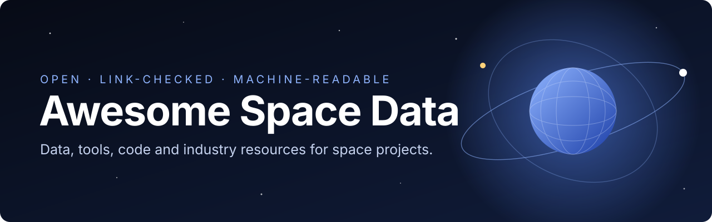

<p align="center">
  
</p>

<p align="center">
  <b>A link-checked, searchable index of open space data, tools, code and industry resources.</b><br>
  For anyone building with space data: apps, research, hackathon projects, start-ups.
</p>

<p align="center">
<!-- STATS:START -->
   
<!-- STATS:END -->
</p>

<p align="center">
  <a href="https://aredwan-xyz.github.io/awesome-space-data/"><b>Search the live site →</b></a>
  &nbsp;·&nbsp; <a href="resources.json">JSON</a>
  &nbsp;·&nbsp; <a href="resources.csv">CSV</a>
  &nbsp;·&nbsp; <a href="CONTRIBUTING.md">Add a resource</a>
</p>

---

## Why this list

Most space-data lists are long, stale and written for people who already know the field.
This one is built to be used:

- **Every link is checked.** A script requests every link each month and flags the ones
  that stop responding (⚠️). The date of the last check is in the badges above.
- **Plain descriptions.** One line each, saying what you can do with it.
- **Access is stated.** Each entry says whether it is open, needs a free key or account,
  or costs money.
- **Machine-readable.** The whole list is one text file, also published as JSON and CSV.
- **Wider than data.** It covers mission software, 3D and media assets, web libraries,
  and the funding, licensing and regulation resources a space venture needs.

## Start in 10 minutes

1. Create an [Earthdata Login](https://urs.earthdata.nasa.gov/). Most NASA Earth-science downloads need it.
2. Get a [NASA API key](https://api.nasa.gov/). One key works for several services.
3. Open the [live site](https://aredwan-xyz.github.io/awesome-space-data/) and search for what you are building.
4. Before designing anything, get **one real value or image** from your main source on screen.

## Pick by what you are building

| Building | Start with |
|---|---|
| Web map or dashboard of Earth | GIBS imagery tiles, NASA Worldview, Leaflet or MapLibre |
| Time series for a place | NASA POWER API, AppEEARS, Open-Meteo |
| Imagery search or analysis | Earth Search or Planetary Computer through STAC, then rasterio or leafmap |
| Fire, storm or disaster tool | FIRMS active-fire API, EONET, Canadian Wildland Fire Information System |
| Moon or Mars map | Moon Trek or Mars Trek, USGS Astrogeology, OpenLayers for polar views |
| Sun, Earth or planet positions | JPL Horizons API, Skyfield, Astronomy Engine, SPICE for precision |
| Satellite tracker | CelesTrak, satellite.js, Launch Library 2 |
| Mission-control interface | Open MCT, Yamcs, OpenC3 COSMOS |
| 3D, AR or VR scene | NASA 3D Resources, CGI Moon Kit, three.js, CesiumJS, A-Frame |
| Space weather or aurora app | NOAA space weather JSON feeds, DONKI, Space Weather Canada |
| Sky or telescope app | MAST, Aladin Lite, astroquery |
| Turning data into sound | Tone.js, Earth Information Center visualizations |
| Venture research | BryceTech reports, Space Capital, NewSpace Index, CSA funding opportunities |

## Use the list as data

```bash
curl -s https://aredwan-xyz.github.io/awesome-space-data/resources.json
```

```js
const { resources } = await (await fetch(
  "https://aredwan-xyz.github.io/awesome-space-data/resources.json")).json();
const openApis = resources.filter(r => r.kind === "API" && r.access === "Open");
```

Each entry has `domain`, `kind`, `name`, `url`, `description`, `access`, `terms`,
`link_ok`, `http_status` and `last_checked`.

<!-- LIST:START -->
## Contents

- [Start here](#start-here) (7)
- [Earth observation](#earth-observation) (78)
- [Canada](#canada) (13)
- [Moon](#moon) (10)
- [Mars](#mars) (9)
- [Solar system and ephemeris](#solar-system-and-ephemeris) (13)
- [Astrophysics](#astrophysics) (15)
- [Sun and space weather](#sun-and-space-weather) (8)
- [Human spaceflight and microgravity](#human-spaceflight-and-microgravity) (10)
- [Orbits and satellites](#orbits-and-satellites) (13)
- [Mission engineering and software](#mission-engineering-and-software) (22)
- [Missions and history](#missions-and-history) (11)
- [Media, 3D and visualization](#media-3d-and-visualization) (20)
- [Web and data libraries](#web-and-data-libraries) (10)
- [Learning](#learning) (4)
- [Ventures and industry](#ventures-and-industry) (17)

## Start here

_Accounts, keys and the main catalogues. Set these up first._

- [Earthdata Login](https://urs.earthdata.nasa.gov/) — Needed to download most NASA Earth-science files. Create it first. `Account` `Free account`
- [NASA Open APIs (api.nasa.gov)](https://api.nasa.gov/) — One key for several JSON services: astronomy picture, near-Earth objects, space weather events, Earth imagery. `API` `Free key`
- [NASA Open Data Portal](https://data.nasa.gov/) — Catalogue of NASA data sets across all directorates. `Catalogue` `Open`
- [NASA Earthdata](https://www.earthdata.nasa.gov/) — Front door to all NASA Earth-science data, tools and tutorials. `Catalogue` `Open`
- [Planetary Data System](https://pds.nasa.gov/) — Master archive for Moon, Mars and planetary mission data. `Archive` `Open`
- [NASA Science Discovery Engine](https://sciencediscoveryengine.nasa.gov/) — One search box across NASA science data, documentation and code. `Search` `Open`
- [CSA Open Data portal](https://donnees-data.asc-csa.gc.ca/) — Canadian Space Agency data sets, including RADARSAT. `Catalogue` `Open`

## Earth observation

_Satellite imagery, weather, fire, radar, farming, catalogues and the tools to read them._

- [Earthdata Search](https://search.earthdata.nasa.gov/) — Find and download any NASA Earth-science data set. `Catalogue` `Free account`
- [Common Metadata Repository (CMR) API](https://cmr.earthdata.nasa.gov/search/site/docs/search/api.html) — Search NASA's Earth-data catalogue from code. `API` `Open`
- [earthaccess (Python)](https://earthaccess.readthedocs.io/) — Search and download NASA Earth data in a few lines of Python. `Library` `Open`
- [GIBS imagery tiles](https://nasa-gibs.github.io/gibs-api-docs/) — Ready-made map tiles of hundreds of NASA Earth layers; drops straight into a web map. `Map tiles` `Open`
- [NASA Worldview](https://worldview.earthdata.nasa.gov/) — Browse the layers GIBS serves; find a layer and date before coding. `Viewer` `Open`
- [AppEEARS](https://appeears.earthdatacloud.nasa.gov/) — Extract a time series for a point or area without handling whole files. `Tool` `Free account`
- [Giovanni](https://giovanni.gsfc.nasa.gov/) — Plot and average Earth-science variables in the browser. `Tool` `Free account`
- [FIRMS active-fire API](https://firms.modaps.eosdis.nasa.gov/api/) — Fire detections as CSV by area and date range. `API` `Free key`
- [NASA POWER API](https://power.larc.nasa.gov/docs/services/api/) — Daily weather and solar values for any point on Earth, back decades. Easy JSON. `API` `Open`
- [EONET natural events](https://eonet.gsfc.nasa.gov/docs/v3) — Live list of wildfires, storms, volcanoes and other events with coordinates. `API` `Open`
- [LP DAAC (land data)](https://lpdaac.usgs.gov/) — NASA's land data centre: vegetation, surface temperature, elevation. `Archive` `Free account`
- [Alaska Satellite Facility (radar)](https://asf.alaska.edu/) — NASA's radar data centre: Sentinel-1, NISAR and older radar missions. `Archive` `Free account`
- [National Snow and Ice Data Center](https://nsidc.org/) — Sea ice, glaciers, snow cover and frozen ground. `Archive` `Free account`
- [PO.DAAC (oceans)](https://podaac.jpl.nasa.gov/) — Sea level, ocean temperature, winds and surface water. `Archive` `Free account`
- [GES DISC (atmosphere and water)](https://disc.gsfc.nasa.gov/) — Rainfall, atmospheric composition and land-surface models. `Archive` `Free account`
- [USGS EarthExplorer](https://earthexplorer.usgs.gov/) — Landsat and other US imagery back to 1972. `Catalogue` `Free account` Reuse: Landsat is public domain.
- [Copernicus Data Space](https://dataspace.copernicus.eu/) — European Sentinel satellite data: radar, optical, atmosphere. `Catalogue` `Free account` Reuse: Free and open with attribution.
- [Copernicus Browser](https://browser.dataspace.copernicus.eu/) — Browse and download Sentinel imagery. `Viewer` `Free account` Reuse: Free and open with attribution.
- [Copernicus Climate Data Store](https://cds.climate.copernicus.eu/) — Climate reanalysis (ERA5) and projections. `Archive` `Free account`
- [Microsoft Planetary Computer](https://planetarycomputer.microsoft.com/) — Large open catalogue of Earth data with a standard search API. `Catalogue` `Open`
- [Earth Search (Element 84)](https://earth-search.aws.element84.com/v1) — Open search API for cloud-hosted Sentinel-2 and Landsat scenes. `API` `Open`
- [Google Earth Engine](https://earthengine.google.com/) — Planet-scale analysis in the cloud without downloading files. `Platform` `Free tier` Reuse: Free for non-commercial use; commercial use is paid.
- [OpenTopography](https://opentopography.org/) — Global and high-resolution elevation data. `Catalogue` `Open`
- [NOAA National Centers for Environmental Information](https://www.ncei.noaa.gov/) — Long-term weather and climate records. `Archive` `Open`
- [Open-Meteo](https://open-meteo.com/) — Weather forecast and history API with no key. `API` `Free tier` Reuse: Free for non-commercial use.
- [ECMWF open data](https://www.ecmwf.int/en/forecasts/datasets/open-data) — Free subset of the European weather forecast model. `Data` `Open`
- [OpenStreetMap](https://www.openstreetmap.org/) — Roads, buildings and places for context layers. `Data` `Open` Reuse: Open licence with attribution.
- [Natural Earth](https://www.naturalearthdata.com/) — Clean country, coastline and physical base maps. `Data` `Open` Reuse: Public domain.
- [STAC (SpatioTemporal Asset Catalog)](https://stacspec.org/) — The standard most modern imagery catalogues use; learn it once, query many. `Standard` `Open`
- [STAC Index](https://stacindex.org/) — Directory of public imagery catalogues and tools that speak STAC. `Catalogue` `Open`
- [Cloud Optimized GeoTIFF](https://cogeo.org/) — Image format that lets a web app read just the part it needs. `Standard` `Open`
- [Source Cooperative](https://source.coop/) — Open data-sharing site with many training-ready Earth data sets. `Catalogue` `Open`
- [NASA and IBM Prithvi geospatial models](https://huggingface.co/ibm-nasa-geospatial) — Open AI models pre-trained on satellite imagery. `Model` `Open`
- [TorchGeo](https://torchgeo.readthedocs.io/) — Data sets and models for machine learning on satellite imagery. `Library` `Open`
- [GDAL](https://gdal.org/) — The base toolkit for converting and reprojecting map data. `Library` `Open`
- [rasterio](https://rasterio.readthedocs.io/) — Read and write satellite images in Python. `Library` `Open`
- [GeoPandas](https://geopandas.org/) — Shapes and boundaries in Python. `Library` `Open`
- [xarray](https://docs.xarray.dev/) — Python for gridded science data files. `Library` `Open`
- [pystac-client](https://pystac-client.readthedocs.io/) — Search STAC imagery catalogues from Python. `Library` `Open`
- [leafmap](https://leafmap.org/) — Interactive mapping and analysis in a notebook with little code. `Library` `Open`
- [TiTiler](https://developmentseed.org/titiler/) — Turn cloud-hosted images into map tiles on the fly. `Library` `Open`
- [QGIS](https://qgis.org/) — Desktop tool to open, inspect and convert map data before coding. `Tool` `Open`
- [NASA ARSET training](https://appliedsciences.nasa.gov/what-we-do/capacity-building/arset) — Free courses on using satellite data for fires, water, farming and disasters. `Learning` `Open`
- [Maxar Open Data Program](https://www.maxar.com/open-data) — High-resolution imagery released for major disasters. `Data` `Open` Reuse: Check each release; often non-commercial.
- [Umbra Open Data](https://umbra.space/open-data/) — Free commercial radar imagery samples. `Data` `Open` Reuse: Check licence per data set.
- [Wyvern Open Data](https://wyvern.space/open-data/) — Free hyperspectral imagery from a Canadian company. `Data` `Open` Reuse: Check licence per data set.
- [SkyWatch EarthCache](https://skywatch.com/) — Buy commercial imagery from many providers through one API (Canadian). `Marketplace` `Paid`
- [FIRMS fire map](https://www.earthdata.nasa.gov/data/tools/firms) — Near-real-time map and downloads of active fires worldwide. `Tool` `Open`
- [ASF Vertex radar search](https://search.asf.alaska.edu/) — Map-based search for radar scenes from Sentinel-1, NISAR and earlier missions. `Catalogue` `Free account`
- [GPM and IMERG rainfall](https://gpm.nasa.gov/data) — Global rainfall estimates every half hour. `Data` `Free account`
- [SMAP soil moisture](https://www.earthdata.nasa.gov/data/platforms/space-based-platforms/smap) — Global surface soil moisture every two to three days. `Data` `Free account`
- [SRTM elevation](https://www.earthdata.nasa.gov/data/instruments/srtm) — Near-global elevation model from the Space Shuttle radar mission. `Data` `Free account`
- [ECOSTRESS](https://ecostress.jpl.nasa.gov/data) — Land-surface temperature and plant water use measured from the space station. `Data` `See site`
- [GEDI forest structure](https://gedi.umd.edu/data) — Laser measurements of forest height and biomass from the space station. `Data` `See site`
- [ERA5 reanalysis](https://cds.climate.copernicus.eu/datasets/reanalysis-era5-single-levels?tab=overview) — Hourly global weather reconstructed back to 1940. `Data` `Free account`
- [NOAA Climate Data Online](https://www.ncei.noaa.gov/cdo-web/) — Historical weather-station records worldwide. `Data` `Open`
- [Hydrology time-series tool](https://disc.gsfc.nasa.gov/information/tools?title=Hydrology%20Time%20Series) — Make a time series of rainfall, soil moisture or runoff for one location. `Tool` `Open`
- [KNMI Climate Explorer](https://climexp.knmi.nl/) — Web tool for climate time series, trends and correlations. `Tool` `Open`
- [ESA Open Science Catalog](https://opensciencedata.esa.int/) — European catalogue of open geoscience data sets, products and workflows. `Catalogue` `Open`
- [JAXA G-Portal](https://gportal.jaxa.jp/gpr/index/index) — Japanese Earth-observation products: rain, snow, vegetation, ocean. `Catalogue` `Free account`
- [SAOCOM catalogue (Argentina)](https://catalogos.conae.gov.ar/catalogo/catalogoSatSaocomInfo.html) — Argentine L-band radar imagery; registration required. `Catalogue` `Free account`
- [Remote sensing basics](https://www.earthdata.nasa.gov/learn/earth-observation-data-basics/remote-sensing) — Plain introduction to how satellite instruments and resolutions work. `Learning` `Open`
- [Radar (SAR) basics](https://www.earthdata.nasa.gov/learn/earth-observation-data-basics/sar) — Plain introduction to imaging radar. `Learning` `Open`
- [NISAR data user guide](https://nisar-docs.asf.alaska.edu/) — How to find, open and use data from the NASA and ISRO radar mission. `Learning` `Open`
- [NISAR application briefs](https://nisar.jpl.nasa.gov/applications/societal-benefit/) — Two-page explainers on what radar can measure, by application. `Learning` `Open`
- [NISAR story maps](https://nisar.jpl.nasa.gov/applications/arcgis-storymaps/) — Worked radar examples for floods, fires, subsidence and glaciers. `Learning` `Open`
- [FAO Global Agro-Ecological Zones](https://gaez.fao.org) — Global maps of crop suitability, soil limits and water availability. `Data` `Open`
- [CoCoRaHS](https://www.cocorahs.org/Maps) — Volunteer-measured daily rain and snow across North America. `Data` `Open`
- [CropScape (US Cropland Data Layer)](https://nassgeodata.gmu.edu/CropScape/) — Yearly 30-metre map of which crop grows where in the United States. `Data` `Open`
- [OpenET](https://openetdata.org) — Field-scale estimates of crop water use for the western United States. `Data` `Open`
- [PRISM climate data](https://prism.oregonstate.edu) — High-resolution US temperature and rainfall grids. `Data` `Open`
- [USDA Ag Data Commons](https://www.nal.usda.gov/services/agdatacommons) — Open US agricultural research data sets. `Catalogue` `Open`
- [USDA NASS Quick Stats](https://quickstats.nass.usda.gov) — US crop yields, acreage and production by county and state. `Data` `Open`
- [Web Soil Survey](https://websoilsurvey.nrcs.usda.gov/app/) — Official US soil maps and properties for any area. `Tool` `Open`
- [NAIP aerial imagery](https://naip-usdaonline.hub.arcgis.com/) — One-metre aerial photos of US farmland in the growing season. `Data` `Open`
- [LANDFIRE](https://www.landfire.gov) — US vegetation and wildfire-fuel maps. `Data` `Open`
- [US National Land Cover Database](https://www.usgs.gov/centers/eros/science/national-land-cover-database) — 30-metre US land cover across several decades. `Data` `Open`
- [USGS water data](https://waterdata.usgs.gov/nwis) — US streamflow, groundwater and water-quality records. `Data` `Open`

## Canada

_Canadian government and agency sources._

- [EODMS (Natural Resources Canada)](https://www.eodms-sgdot.nrcan-rncan.gc.ca/) — Canada's Earth-observation archive, including RADARSAT. `Catalogue` `Free account`
- [Open Government Portal](https://open.canada.ca/) — Federal open data across all departments. `Catalogue` `Open` Reuse: Open Government Licence – Canada.
- [GEO.ca](https://geo.ca/) — Canada's geospatial data hub. `Catalogue` `Open`
- [Canadian Wildland Fire Information System](https://cwfis.cfs.nrcan.gc.ca/) — Fire weather, hotspots and burned-area maps. `Data` `Open`
- [MSC GeoMet (Environment Canada weather)](https://eccc-msc.github.io/open-data/msc-geomet/readme_en/) — Canadian weather and climate layers as map services. `API` `Open`
- [Space Weather Canada](https://www.spaceweather.gc.ca/) — Canadian geomagnetic forecasts and aurora conditions. `Data` `Open`
- [Canadian Astronomy Data Centre](https://www.cadc-ccda.hia-iha.nrc-cnrc.gc.ca/en/) — Canadian telescope archives, including NEOSSat. `Archive` `Open`
- [CSA on GitHub](https://github.com/asc-csa) — Canadian Space Agency tutorials and notebooks. `Code` `Open`
- [RADARSAT Constellation Mission data](https://donnees-data.asc-csa.gc.ca/en/dataset/rcm) — Canada's three-satellite radar constellation. `Data` `See site` Reuse: Access rules vary by user type.
- [RADARSAT-1 data](https://donnees-data.asc-csa.gc.ca/en/dataset/radarsat1) — Archive of Canada's first radar satellite, 1995 to 2013. `Data` `Open`
- [CSA radar Python tutorial](https://github.com/asc-csa/Synthetic_Aperture_Radar_Tutorial) — Step-by-step notebook for working with radar imagery in Python and QGIS. `Code` `Open`
- [NEOSSat data](https://data.asc-csa.gc.ca/dataset/neossat) — Images from Canada's asteroid- and debris-tracking space telescope. `Data` `Open`
- [NEOSSat Python tutorial](https://github.com/asc-csa/NEOSSAT_Tutorial) — Notebook for opening and plotting NEOSSat images. `Code` `Open`

## Moon

_Imagery, terrain, temperature and viewers._

- [LROC Quickmap](https://quickmap.lroc.asu.edu/) — Interactive Moon map with imagery, terrain and many science layers. `Viewer` `Open`
- [Moon Trek](https://trek.nasa.gov/moon/) — 3D Moon viewer whose layers can also be used as map tiles. `Viewer` `Open`
- [LROC image archive](https://www.lroc.asu.edu/) — Lunar Reconnaissance Orbiter Camera images and mosaics. `Data` `Open`
- [LOLA lunar topography (PDS Geosciences)](https://pds-geosciences.wustl.edu/missions/lro/lola.htm) — Lunar elevation models; the terrain source for horizon and slope work. `Data` `Open`
- [Diviner lunar temperatures](https://pds-geosciences.wustl.edu/missions/lro/diviner.htm) — Surface temperature maps of the Moon. `Data` `Open`
- [Planetary Geodesy Data Archive](https://pgda.gsfc.nasa.gov/) — Ready-made lunar products including south-pole terrain and illumination maps. `Data` `Open`
- [CGI Moon Kit](https://svs.gsfc.nasa.gov/4720/) — Colour and elevation maps of the Moon made for 3D rendering. `Media` `Open`
- [Lunar and Planetary Institute](https://www.lpi.usra.edu/) — Lunar atlases, sample catalogues and south-pole references. `Reference` `Open`
- [Kaguya (SELENE) data archive](https://darts.isas.jaxa.jp/planet/pdap/selene/) — Japanese lunar orbiter data, including terrain. `Archive` `Open`
- [LRO data at PDS Geosciences](https://pds-geosciences.wustl.edu/missions/lro/) — All Lunar Reconnaissance Orbiter instrument archives in one place. `Archive` `Open`

## Mars

_Imagery, terrain, weather and viewers._

- [Mars Trek](https://trek.nasa.gov/mars/) — 3D Mars viewer whose layers can also be used as map tiles. `Viewer` `Open`
- [HiRISE](https://www.uahirise.org/) — Highest-resolution images and terrain models of Mars. `Data` `Open`
- [Global CTX mosaic of Mars](https://murray-lab.caltech.edu/CTX/) — Seamless medium-resolution image map of all of Mars. `Data` `Open`
- [JMARS](https://jmars.asu.edu/) — Desktop mapping tool used by Mars mission teams. `Tool` `Free account`
- [PDS Atmospheres Node](https://pds-atmospheres.nmsu.edu/) — Mars weather and atmosphere records from landers and rovers. `Archive` `Open`
- [PDS Cartography and Imaging Sciences Node](https://pds-imaging.jpl.nasa.gov/) — Raw and processed images from planetary missions. `Archive` `Open`
- [Mars Climate Database](http://www-mars.lmd.jussieu.fr/) — Modelled Mars weather for any place and season. `Model` `Open`
- [Perseverance raw images](https://mars.nasa.gov/mars2020/multimedia/raw-images/) — Every image the rover sends back. `Media` `Open`
- [USGS interactive geologic maps of Mars](https://astrogeology-usgs.hub.arcgis.com/pages/interactive-maps-mars) — Standardised geologic maps of Mars in a web viewer. `Viewer` `Open`

## Solar system and ephemeris

_Where things are: positions of bodies and spacecraft, asteroids, planetary archives._

- [JPL Horizons API](https://ssd-api.jpl.nasa.gov/doc/horizons.html) — Positions of the Sun, planets and spacecraft as seen from any body or surface point. `API` `Open`
- [JPL Horizons System](https://ssd.jpl.nasa.gov/horizons/) — The same service as a web form; good for checking a result by hand. `Tool` `Open`
- [JPL Solar System Dynamics APIs](https://ssd-api.jpl.nasa.gov/) — Small-body database, close approaches, fireballs and related services. `API` `Open`
- [CNEOS near-Earth objects](https://cneos.jpl.nasa.gov/) — Asteroid close approaches and impact risk. `Data` `Open`
- [NAIF SPICE toolkit](https://naif.jpl.nasa.gov/naif/) — NASA's geometry system for spacecraft and planetary positions. `Toolkit` `Open`
- [SpiceyPy](https://spiceypy.readthedocs.io/) — Use SPICE from Python. `Library` `Open`
- [Skyfield](https://rhodesmill.org/skyfield/) — Simple, accurate positions of planets and satellites in Python. `Library` `Open`
- [Astronomy Engine](https://github.com/cosinekitty/astronomy) — Sun, Moon and planet positions in JavaScript, Python, C and C#. `Library` `Open`
- [USGS Astrogeology](https://astrogeology.usgs.gov/) — Global maps and mosaics for the Moon, Mars and other bodies in standard map formats. `Data` `Open`
- [ESA Planetary Science Archive](https://psa.esa.int/) — Data from European planetary missions. `Archive` `Open`
- [Minor Planet Center](https://www.minorplanetcenter.net/) — Official orbits for asteroids and comets. `Data` `Open`
- [NASA Eyes](https://eyes.nasa.gov/) — Real-time 3D views of spacecraft, planets and asteroids; a reference for interaction design. `Viewer` `Open`
- [NASA Trajectory Browser](https://trajbrowser.arc.nasa.gov/) — Find launch windows and trajectories to planets and asteroids. `Tool` `Open`

## Astrophysics

_Telescope archives, sky viewers and catalogues._

- [MAST (Hubble, Webb, TESS, Kepler)](https://archive.stsci.edu/) — Space-telescope images and light curves. `Archive` `Open`
- [NASA/IPAC Infrared Science Archive](https://irsa.ipac.caltech.edu/) — Infrared sky surveys including SPHEREx and WISE. `Archive` `Open`
- [HEASARC](https://heasarc.gsfc.nasa.gov/) — X-ray and gamma-ray mission data. `Archive` `Open`
- [NASA Exoplanet Archive](https://exoplanetarchive.ipac.caltech.edu/) — Confirmed planets and their properties, with an API. `Archive` `Open`
- [Gaia Archive](https://gea.esac.esa.int/archive/) — Positions and motions of nearly two billion stars. `Archive` `Open`
- [ESASky](https://sky.esa.int/) — Browse the whole sky across many telescopes. `Viewer` `Open`
- [Aladin Lite](https://aladin.cds.unistra.fr/AladinLite/) — Embeddable sky map for a web page. `Library` `Open`
- [SkyView](https://skyview.gsfc.nasa.gov/) — Cut out an image of any sky position from many surveys. `Tool` `Open`
- [SIMBAD](https://simbad.cds.unistra.fr/) — Look up any named star or galaxy. `Database` `Open`
- [NASA Astrophysics Data System](https://ui.adsabs.harvard.edu/) — Search the astronomy and physics literature. `Search` `Open`
- [Astropy](https://www.astropy.org/) — Python astronomy: coordinates, time systems, image files. `Library` `Open`
- [astroquery](https://astroquery.readthedocs.io/) — Query astronomy archives from Python. `Library` `Open`
- [Zooniverse](https://www.zooniverse.org/) — Build or join citizen-science projects. `Platform` `Open`
- [SPHEREx data at IRSA](https://irsa.ipac.caltech.edu/Missions/spherex.html) — All-sky infrared survey in 102 colours, repeated every six months. `Data` `Open`
- [SPHEREx tutorial notebooks](https://caltech-ipac.github.io/irsa-tutorials/spherex/) — Worked Python examples for fetching and viewing SPHEREx images. `Learning` `Open`

## Sun and space weather

_Solar images, storms and aurora feeds._

- [DONKI space weather events](https://ccmc.gsfc.nasa.gov/tools/DONKI/) — Solar flares, eruptions and storms as a searchable record. `API` `Free key`
- [NOAA Space Weather Prediction Center](https://www.swpc.noaa.gov/products-and-data) — Forecasts, alerts and aurora maps. `Data` `Open`
- [NOAA space weather JSON feeds](https://services.swpc.noaa.gov/) — Live solar wind, aurora and geomagnetic data as plain JSON. `API` `Open`
- [Solar Dynamics Observatory](https://sdo.gsfc.nasa.gov/data/) — Near-live images of the Sun in many wavelengths. `Data` `Open`
- [Helioviewer](https://helioviewer.org/) — Browse and make movies of solar images; has an API. `Viewer` `Open`
- [CDAWeb](https://cdaweb.gsfc.nasa.gov/) — Space-physics measurements from dozens of spacecraft. `Archive` `Open`
- [SunPy](https://sunpy.org/) — Python for solar data. `Library` `Open`
- [Community Coordinated Modeling Center](https://ccmc.gsfc.nasa.gov/) — Space weather models and tools. `Models` `Open`

## Human spaceflight and microgravity

_Space biology, microgravity experiments and crew health._

- [Open Science Data Repository](https://osdr.nasa.gov/bio/repo/) — Space biology and astronaut-relevant experiment data, with an API. `Archive` `Open`
- [Physical Sciences Informatics](https://psi.nasa.gov/) — Microgravity experiments: combustion, fluids, materials. `Archive` `Open`
- [NASA Human Research Program: hazards and risks](https://www.nasa.gov/hrp/hazards/) — The five hazards of spaceflight and the risks NASA tracks. `Reference` `Open`
- [Spot the Station](https://www.nasa.gov/spot-the-station/) — When the space station passes over a location. `Tool` `Open`
- [NASA Life Sciences Portal](https://nlsp.nasa.gov/) — Astronaut and life-science study records. `Archive` `Open`
- [RadLab radiation dosimetry](https://visualization.osdr.nasa.gov/radlab/gui/data-api/) ⚠️ — Radiation doses measured aboard the space station, with an API. `API` `Open`
- [Human spaceflight risks](https://www.nasa.gov/hrp/risks/) — The individual health risks NASA tracks for long missions. `Reference` `Open`
- [Ongoing Human Research Program studies](https://www.nasa.gov/hrp/ongoing-hrp-research/) — Current studies of how spaceflight affects the body. `Reference` `Open`
- [NASA combustion science programme](https://www.nasa.gov/glenn/glenn-expertise-space-exploration/physical-sciences-program/combustion-science/) — Summaries of the microgravity fire investigations behind the data. `Reference` `Open`
- [Researcher's guide to ISS combustion science](https://www.nasa.gov/missions/station/a-researchers-guide-to-combustion-science/) — Overview of fire experiments on the space station and why flames behave differently there. `Learning` `Open`

## Orbits and satellites

_Orbit data, launch schedules and satellite databases._

- [CelesTrak](https://celestrak.org/) — Current orbit data for satellites and debris. `Data` `Open`
- [Space-Track](https://www.space-track.org/) — The US government's official satellite catalogue. `Data` `Free account` Reuse: Redistribution is restricted.
- [Launch Library 2](https://thespacedevs.com/llapi) — Launch schedule, rockets and events as an API. `API` `Free tier`
- [SatNOGS](https://satnogs.org/) — Open network of ground stations and a database of satellite transmitters. `Network` `Open`
- [General Catalog of Artificial Space Objects](https://planet4589.org/space/gcat/) — Every object ever launched, maintained by Jonathan McDowell. `Database` `Open`
- [Gunter's Space Page](https://space.skyrocket.de/) — Reference pages for nearly every satellite and rocket. `Database` `Open`
- [eoPortal](https://www.eoportal.org/) — Detailed write-ups of Earth-observation missions. `Database` `Open`
- [OSCAR (World Meteorological Organization)](https://space.oscar.wmo.int/) — Satellites and instruments by what they measure. `Database` `Open`
- [NASA Orbital Debris Program Office](https://orbitaldebris.jsc.nasa.gov/) — Debris environment reports and models. `Reference` `Open`
- [satellite.js](https://github.com/shashwatak/satellite-js) — Compute satellite positions in the browser. `Library` `Open`
- [sgp4 (Python)](https://pypi.org/project/sgp4/) — Compute satellite positions in Python. `Library` `Open`
- [KeepTrack](https://www.keeptrack.space/) — Open-source 3D satellite tracker. `Viewer` `Open`
- [NewSpace Index](https://www.newspace.im/) — Tracker of satellite constellations and small-satellite companies. `Database` `Open`

## Mission engineering and software

_Mission-control and flight software, handbooks and standards._

- [Open MCT](https://nasa.github.io/openmct/) — NASA's web framework for mission-control telemetry displays. `Framework` `Open`
- [Yamcs](https://yamcs.org/) — Open-source mission control system. `Framework` `Open`
- [OpenC3 COSMOS](https://openc3.com/) — Open-source command and telemetry system for testing and operations. `Framework` `Open`
- [F Prime](https://fprime.jpl.nasa.gov/) — JPL's flight software framework for small spacecraft. `Framework` `Open`
- [core Flight System (cFS)](https://github.com/nasa/cFS) — NASA's reusable flight software. `Framework` `Open`
- [General Mission Analysis Tool (GMAT)](https://software.nasa.gov/software/GSC-19468-1) — Design and optimise spacecraft trajectories. `Tool` `Open`
- [Orekit](https://www.orekit.org/) — Space flight dynamics library. `Library` `Open`
- [NASA on GitHub](https://github.com/nasa) — NASA's open-source code. `Code` `Open`
- [code.nasa.gov](https://code.nasa.gov/) — Directory of NASA open-source projects. `Code` `Open`
- [NASA Software Catalog](https://software.nasa.gov/) — Released NASA software, some downloadable at once, some on request. `Code` `Varies`
- [NASA Technical Reports Server](https://ntrs.nasa.gov/) — Decades of NASA engineering and science reports. `Reference` `Open`
- [NASA Systems Engineering Handbook](https://www.nasa.gov/reference/systems-engineering-handbook/) — How NASA runs a project from concept to operations. `Reference` `Open`
- [NASA Technical Standards](https://standards.nasa.gov/) — Engineering standards NASA projects follow. `Reference` `Open`
- [State-of-the-Art Small Spacecraft Technology](https://www.nasa.gov/smallsat-institute/sst-soa/) — Yearly survey of what small-satellite hardware exists. `Reference` `Open`
- [NASA Lessons Learned](https://llis.nasa.gov/) — What went wrong on past projects and why. `Reference` `Open`
- [CCSDS standards](https://public.ccsds.org/) — The data and communication standards space agencies share. `Standard` `Open`
- [Libre Space Foundation](https://libre.space/) — Open-source space hardware and software projects. `Community` `Open`
- [How NASA designs science missions](https://www.nasa.gov/wp-content/uploads/2025/04/250323-design-and-develop-science-mission.pdf) — Short overview of a mission's path from idea to operations. `Reference` `Open`
- [Concept Maturity Levels](https://dataverse.jpl.nasa.gov/dataset.xhtml?persistentId=hdl:2014/44299) — JPL's scale for how developed a mission concept is. `Reference` `Open`
- [Mission Design Lab](https://etd.gsfc.nasa.gov/capabilities/integrated-design-center/mission-design-lab/) — How NASA Goddard runs rapid mission concept studies. `Reference` `Open`
- [NASA Mission Viz](https://nasa.github.io/mission-viz/) — Web tool for exploring mission concepts and their architectures. `Viewer` `Open`
- [CubeSat 101](https://www3.nasa.gov/sites/default/files/atoms/files/nasa_csli_cubesat_101_508.pdf) — NASA's guide for first-time CubeSat builders, from concept to launch. `Learning` `Open`

## Missions and history

_Past spacecraft and what they did._

- [NASA Space Science Data Coordinated Archive](https://nssdc.gsfc.nasa.gov/) — Master catalogue of every spacecraft and experiment, with dates and locations. `Archive` `Open`
- [Surveyor landers](https://science.nasa.gov/mission/surveyor-3/) — The 1960s robotic landers that proved a soft Moon landing was possible. `Mission page` `Open`
- [Viking 1 and 2](https://science.nasa.gov/mission/viking-1/) — The first US landers to operate on Mars, in 1976. `Mission page` `Open`
- [Mars Pathfinder and Sojourner](https://science.nasa.gov/mission/mars-pathfinder/) — The first rover on Mars, 1997. `Mission page` `Open`
- [Spirit and Opportunity](https://science.nasa.gov/mission/mars-exploration-rovers-spirit-and-opportunity/) — Twin Mars rovers that far outlived their planned missions. `Mission page` `Open`
- [InSight](https://science.nasa.gov/mission/insight/) — Mars lander that recorded marsquakes until its solar panels were buried in dust. `Mission page` `Open`
- [Ingenuity helicopter](https://science.nasa.gov/mission/mars-2020-perseverance/ingenuity-mars-helicopter/) — The first aircraft to fly on another planet. `Mission page` `Open`
- [Pioneer 10 and 11](https://science.nasa.gov/mission/pioneer-10/) — The first probes to cross the asteroid belt and fly past Jupiter and Saturn. `Mission page` `Open`
- [Dawn](https://science.nasa.gov/mission/dawn/) — Orbited and mapped both Vesta and Ceres. `Mission page` `Open`
- [NEAR Shoemaker](https://science.nasa.gov/mission/near-shoemaker/) — The first spacecraft to orbit and land on an asteroid. `Mission page` `Open`
- [Kepler space telescope](https://science.nasa.gov/mission/kepler/) — Found thousands of planets around other stars. `Mission page` `Open`

## Media, 3D and visualization

_Images, video, 3D models, textures and finished visualizations._

- [NASA Image and Video Library](https://images.nasa.gov/) — Photos, video and audio, with a JSON API. `Media` `Open` Reuse: Generally free to use; no NASA logo or implied endorsement.
- [Scientific Visualization Studio](https://svs.gsfc.nasa.gov/) — Thousands of finished NASA visualizations with downloadable frames. `Media` `Open`
- [NASA 3D Resources](https://science.nasa.gov/3d-resources/) — Spacecraft, landers and terrain models for 3D, AR and games. `3D models` `Open`
- [Blue Marble](https://visibleearth.nasa.gov/collection/1484/blue-marble) — Cloud-free whole-Earth images for globes. `Media` `Open`
- [Deep Star Maps](https://svs.gsfc.nasa.gov/4851/) — Star-field backgrounds for 3D scenes. `Media` `Open`
- [Solar System Scope textures](https://www.solarsystemscope.com/textures/) ⚠️ — Planet and moon surface textures. `Media` `Open` Reuse: Attribution required.
- [NASA media usage guidelines](https://www.nasa.gov/nasa-brand-center/images-and-media/) — What you may and may not do with NASA images and the NASA name. `Reference` `Open`
- [ESA images](https://www.esa.int/ESA_Multimedia/Images) — European Space Agency photo library. `Media` `Open` Reuse: Check licence per image.
- [Webb Space Telescope images](https://webbtelescope.org/) — Full-resolution Webb images. `Media` `Open`
- [Earth Information Center visualizations](https://svs.gsfc.nasa.gov/gallery/earth-information-center/) — Gallery of NASA's Earth dashboard visuals with downloadable frames. `Media` `Open`
- [Night lights change, 2012 to 2023](https://svs.gsfc.nasa.gov/5313/) — Where city lights grew and faded over a decade. `Media` `Open`
- [Sea surface currents and temperature](https://svs.gsfc.nasa.gov/3912/) — Animated ocean currents coloured by temperature. `Media` `Open`
- [Global aerosols](https://svs.gsfc.nasa.gov/5669/) — Smoke, dust and sea salt moving through the atmosphere. `Media` `Open`
- [Air quality model runs](https://svs.gsfc.nasa.gov/5533/) — High-resolution frames of modelled air pollution. `Media` `Open`
- [Perpetual Ocean 2](https://svs.gsfc.nasa.gov/5425/) — Flow maps of the major ocean boundary currents. `Media` `Open`
- [Global carbon dioxide](https://svs.gsfc.nasa.gov/5196/) — Carbon dioxide swirling through the atmosphere over a year. `Media` `Open`
- [Lightning seen from the space station](https://svs.gsfc.nasa.gov/5011/) — Six years of lightning flashes mapped from orbit. `Media` `Open`
- [Atmospheric river in 3D](https://svs.gsfc.nasa.gov/4960/) — A 3D model view following one atmospheric river. `Media` `Open`
- [Forest height from GEDI](https://svs.gsfc.nasa.gov/4950/) — Global map of tree canopy height. `Media` `Open`
- [Data sonification example](https://svs.gsfc.nasa.gov/13786/) — How NASA turns an astronomical image into sound. `Media` `Open`

## Web and data libraries

_Mapping, 3D, charts and sound in the browser._

- [Leaflet](https://leafletjs.com/) — The simplest way to put a map with layers on a page. `Library` `Open`
- [MapLibre GL JS](https://maplibre.org/) — Fast web maps with custom tile layers. `Library` `Open`
- [OpenLayers](https://openlayers.org/) — Web maps with strong support for unusual projections such as polar views. `Library` `Open`
- [proj4js](http://proj4js.org/) — Convert coordinates between map projections in the browser. `Library` `Open`
- [CesiumJS](https://cesium.com/platform/cesiumjs/) — 3D globes and terrain in the browser. `Library` `Open`
- [three.js](https://threejs.org/) — 3D scenes in the browser; the base for most web 3D and AR. `Library` `Open`
- [A-Frame](https://aframe.io/) — VR and AR scenes in plain HTML. `Library` `Open`
- [deck.gl](https://deck.gl/) — Large point and grid data sets on a map. `Library` `Open`
- [D3](https://d3js.org/) — Custom charts, calendars and timelines. `Library` `Open`
- [Tone.js](https://tonejs.github.io/) — Synthesised sound in the browser; the base for turning data into audio. `Library` `Open`

## Learning

_Courses, primers and classroom material._

- [CSA digital games and activities](https://www.asc-csa.gc.ca/eng/youth-educators/digital-games-and-activities.asp) — Canadian Space Agency games, e-books and hands-on activities. `Learning` `Open`
- [CSA resources for STEM and youth groups](https://www.asc-csa.gc.ca/eng/youth-educators/resources-stem-and-youth-organizations.asp) — Free bilingual activities for educators and youth leaders. `Learning` `Open`
- [Food production on the Moon toolkit](https://www.asc-csa.gc.ca/eng/youth-educators/toolkits/food-production/) — Classroom material on growing food in space and remote places. `Learning` `Open`
- [Build a space telescope game](https://science.nasa.gov/mission/webb/game-build-it-yourself/) — Design a telescope under real trade-offs; a model for educational mission games. `Learning` `Open`

## Ventures and industry

_Funding, licensing, regulation, news and market reports._

- [CSA funding opportunities](https://www.asc-csa.gc.ca/eng/funding-programs/funding-opportunities/) — Open calls from the Canadian Space Agency. `Funding` `Varies`
- [CSA Space Technology Development Program](https://www.asc-csa.gc.ca/eng/funding-programs/programs/stdp/) — Contracts and contributions for Canadian space technology. `Funding` `Varies`
- [CSA smartEarth](https://www.asc-csa.gc.ca/eng/funding-programs/programs/smartearth/) — Funding for applications built on satellite data. `Funding` `Varies`
- [NASA Technology Transfer](https://technology.nasa.gov/) — NASA patents and software available to license. `Licensing` `Varies`
- [NASA Spinoff](https://spinoff.nasa.gov/) — How NASA technology became commercial products. `Reference` `Open`
- [NASA SBIR and STTR](https://sbir.nasa.gov/) — NASA's small-business research contracts. `Funding` `Varies` Reuse: US small businesses only.
- [ESA Commercialisation Gateway](https://commercialisation.esa.int/) — European incubators, funding and partnerships. `Funding` `Varies`
- [Creative Destruction Lab: Space](https://creativedestructionlab.com/streams/space/) — Canadian-founded mentoring programme for space start-ups. `Programme` `Varies`
- [Space Canada](https://space-canada.ca/) — Canada's space industry association and member list. `Association` `Open`
- [SpaceQ](https://spaceq.ca/) — Canadian space industry news. `News` `Open`
- [SpaceNews](https://spacenews.com/) — Global space industry news. `News` `Open`
- [Payload](https://payloadspace.com/) — Business-focused space news and data. `News` `Open`
- [BryceTech reports](https://brycetech.com/reports) — Free launch, satellite and investment statistics. `Reports` `Open`
- [Space Capital](https://www.spacecapital.com/) — Quarterly space investment reports. `Reports` `Open`
- [Factories in Space](https://www.factoriesinspace.com/) — Directory of in-space manufacturing and commercial station companies. `Database` `Open`
- [Controlled Goods Program (Canada)](https://www.tpsgc-pwgsc.gc.ca/pmc-cgp/index-eng.html) — Registration required to handle controlled space and defence technology in Canada. `Regulation` `Open`
- [UN Office for Outer Space Affairs](https://www.unoosa.org/) — Space treaties, registration of objects and national space laws. `Regulation` `Open`
<!-- LIST:END -->

## How reliable is this

- **Checked:** that each link answers. `⚠️` marks links that did not respond at the last
  check. Some sites refuse automated requests and still work in a browser; those are
  recorded as "refused checker" in the data and not marked here.
- **Not checked:** whether a service still offers exactly what its description says.
- **Access and reuse notes are pointers, not legal advice.** Confirm on the provider's own
  terms page before you build a product on a source.

### Before you use a source in a product

- NASA data and images are generally free to reuse, but the NASA name and logo may not be
  used to suggest endorsement.
- European Sentinel data is free and open with attribution. Landsat is public domain.
- Commercial "open data" releases are often for non-commercial use only.
- Some free services charge for commercial use, and some catalogues restrict redistribution.
- Some data and technology are restricted by nationality or registration.
- Keep a record of each source, its link, the date you accessed it and its licence.

## Working rules for space data

- **Tiles and APIs before raw files.** Raw science files are large and slow to learn.
- **Shrink the area and time range** until your demo is fast.
- **Cache what you fetch.** A product should not break because a public service is down.
- **Some services refuse requests made directly from a web page.** Fetch on a server or
  with a script and serve the saved result.
- **Moon and Mars maps use different coordinate systems from Earth maps**, and polar
  regions use a polar projection. Check before mixing layers.
- **Say what is simulated** whenever real data is mixed with made-up values.

## Contributing

Add a line to [`resources.tsv`](resources.tsv) and open a pull request. The format and the
bar for inclusion are in [CONTRIBUTING.md](CONTRIBUTING.md). Found a dead link? Open an issue.

## Licence

The list and data are released under [CC0 1.0](LICENSE) (public domain). The code
(`build.py`, `template.html`, workflows) is under the [MIT licence](LICENSE-CODE).

## Disclaimer

This is an independent community project. It is not affiliated with or endorsed by NASA,
the Canadian Space Agency, ESA or any organisation listed. Names and trademarks belong to
their owners. Each linked resource is governed by its own terms.

Started during the 2026 NASA Space Apps Challenge weekend. Maintained by
[aredwan-xyz](https://github.com/aredwan-xyz).
